# Apache ECharts for Filament

<div class="filament-hidden">

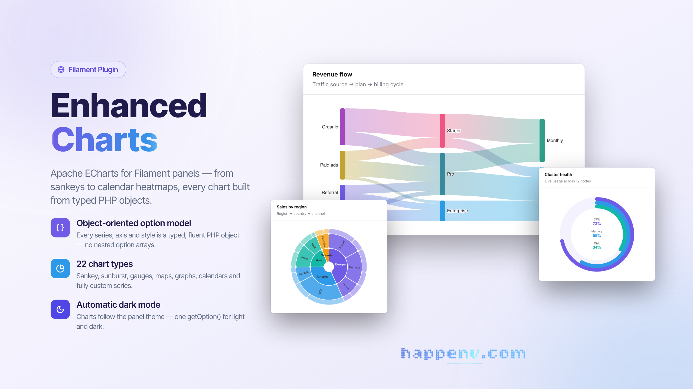

</div>

[](https://github.com/happenv-com/filament-enhanced-charts/releases)
[](https://github.com/happenv-com/filament-enhanced-charts/actions/workflows/tests.yml)
[](https://github.com/happenv-com/filament-enhanced-charts/actions/workflows/phpstan.yml)
[](https://github.com/happenv-com/filament-enhanced-charts/actions/workflows/quality.yml)
[](https://packagist.org/packages/happenv-com/filament-enhanced-charts)
[](https://github.com/happenv-com/filament-enhanced-charts/blob/1.x/LICENSE.md)

[Apache ECharts](https://echarts.apache.org/) integration for [Filament](https://filamentphp.com/):
dashboard **widgets** and table **columns** driven by a fully typed, fluent PHP option model.

```php
class OrdersChart extends EnhancedChartWidget
{
    protected static ?string $heading = 'Orders per day';

    protected function getOption(): Option
    {
        return Option::cartesian()
            ->xAxis(CategoryAxis::make()->data(['Mon', 'Tue', 'Wed']))
            ->series(LineSeries::make()->name('Orders')->smooth()->data([12, 20, 15]));
    }
}
```

## Key features

- **Typed option model.** The ECharts option tree is mirrored as fluent PHP builders — if you know an ECharts option, you know the method — and everything not (yet) modelled stays reachable through a `->raw()` escape hatch on every node ([The option model](#the-option-model)).
- **23 series types.** Line, bar, pie, scatter, effectScatter, candlestick, boxplot, heatmap, radar, gauge, funnel, sankey, chord, sunburst, treemap, tree, graph, parallel, themeRiver, pictorialBar, map, lines, and fully custom `renderItem` series.
- **Every coordinate system.** Cartesian grids, polar, radar, geo/maps, calendar, singleAxis, parallel and matrix — plus datasets with transforms, visual maps, data zoom, toolbox, brush and graphic elements.
- **Filament-native.** Panel theming, automatic [dark mode](#dark-mode), Filament `Color` palettes, `RawJs` for [client-side callbacks](#formatters-and-js-callbacks), Livewire polling, deferred loading and [filters](#filtering-chart-data).
- **Data straight from Eloquent.** `ChartData::fromPairs()`, `ChartData::fromTimeSeries()` (laravel-trend compatible) and `Dataset::fromModels()` turn query results into chart data, and `HasChartData` builds a whole chart from data and a type ([Feeding data from Eloquent](#feeding-data-from-eloquent)). A tabular `ChartDataset` plus a preset name draws any suitable chart without choosing a chart type ([Chart presets](#chart-presets-a-chart-from-a-dataset-without-knowing-chart-types)).
- **64 languages.** Month and day names, toolbox and aria strings follow the app locale in every language Filament ships ([Translations](#translations)).
- **Charts in table cells.** Sparklines, candlesticks and donut pies inside table cells via `EnhancedChartColumn`, or any custom per-record chart ([Charts in table cells](#charts-in-table-cells)).
- **Testable.** Livewire assertions for the resolved chart options in your application's tests ([Testing your application](#testing-your-application)), and the package itself is covered by a Pest suite on every supported version combination.

## Gallery

A taste of what the typed option model draws — every chart is a regular widget class, and follows your panel's light or dark mode automatically.

<table>
<tr>
<td width="33%" align="center"><a href="https://github.com/happenv-com/filament-enhanced-charts/blob/1.x/DEMO.md#horizontal-sankey"><picture><source media="(prefers-color-scheme: dark)" srcset="screens/sankey-dark.png">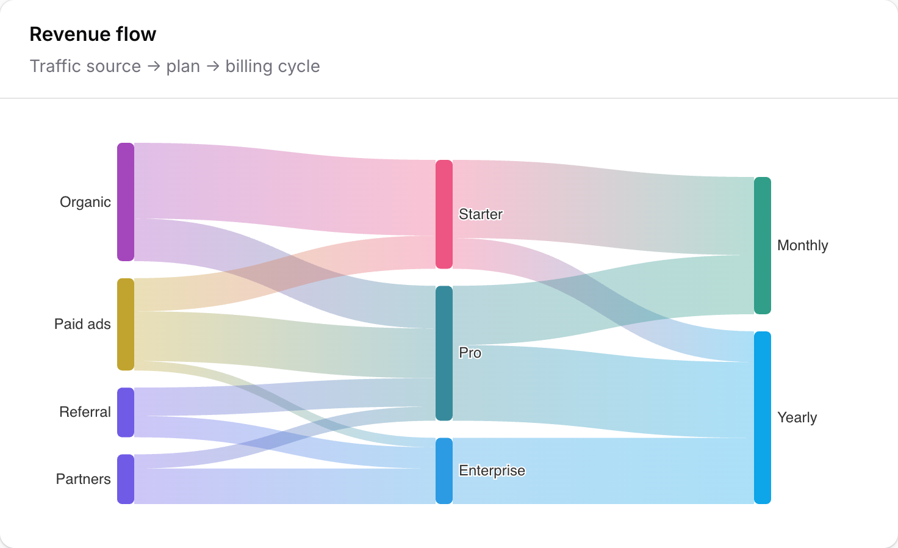</picture></a><br><sub><b>Sankey</b></sub></td>
<td width="33%" align="center"><a href="https://github.com/happenv-com/filament-enhanced-charts/blob/1.x/DEMO.md#three-level-sunburst"><picture><source media="(prefers-color-scheme: dark)" srcset="screens/sunburst-dark.png">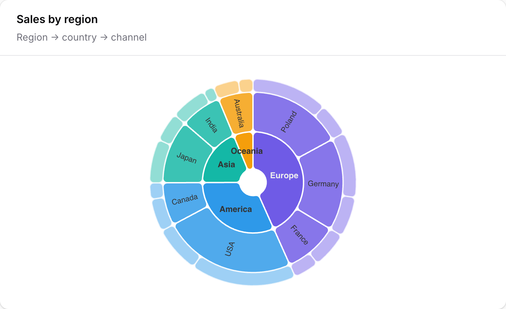</picture></a><br><sub><b>Sunburst</b></sub></td>
<td width="33%" align="center"><a href="https://github.com/happenv-com/filament-enhanced-charts/blob/1.x/DEMO.md#animated-routes-on-a-map"><picture><source media="(prefers-color-scheme: dark)" srcset="screens/lines-dark.gif">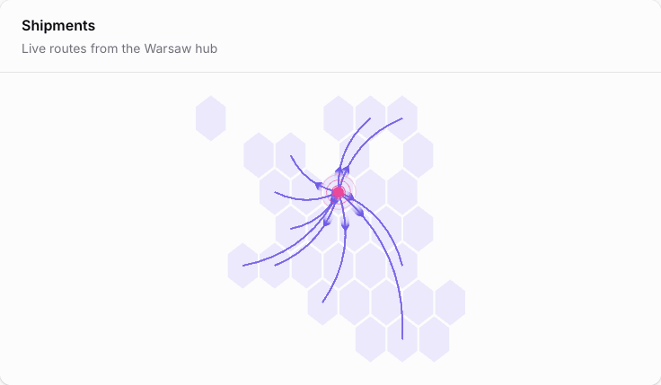</picture></a><br><sub><b>Animated routes</b></sub></td>
</tr>
<tr>
<td width="33%" align="center"><a href="https://github.com/happenv-com/filament-enhanced-charts/blob/1.x/DEMO.md#calendar-heatmap"><picture><source media="(prefers-color-scheme: dark)" srcset="screens/heatmap-calendar-dark.png">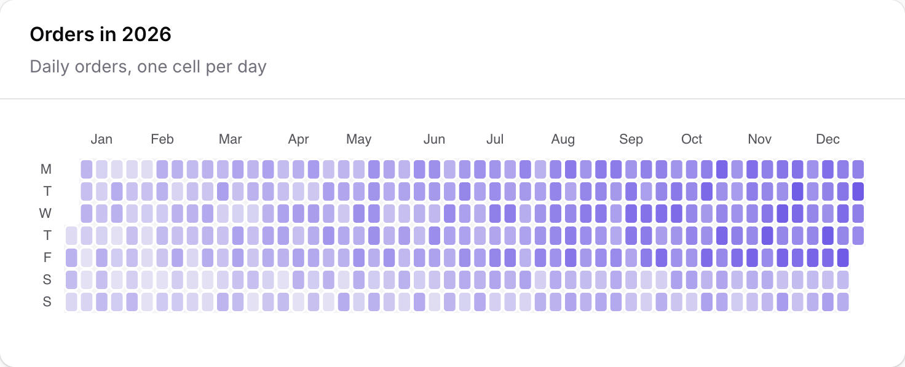</picture></a><br><sub><b>Calendar heatmap</b></sub></td>
<td width="33%" align="center"><a href="https://github.com/happenv-com/filament-enhanced-charts/blob/1.x/DEMO.md#progress-rings"><picture><source media="(prefers-color-scheme: dark)" srcset="screens/gauge-rings-dark.png">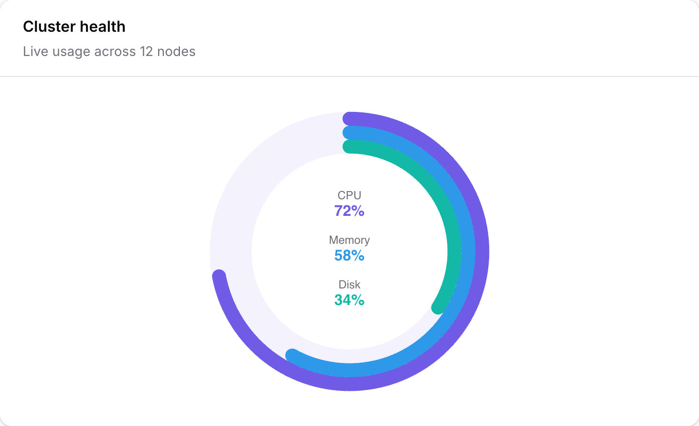</picture></a><br><sub><b>Progress rings</b></sub></td>
<td width="33%" align="center"><a href="https://github.com/happenv-com/filament-enhanced-charts/blob/1.x/DEMO.md#polar-bars"><picture><source media="(prefers-color-scheme: dark)" srcset="screens/bar-polar-dark.png">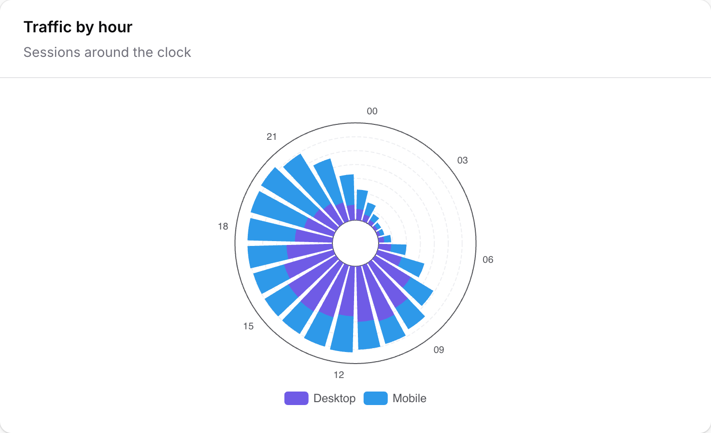</picture></a><br><sub><b>Polar bars</b></sub></td>
</tr>
<tr>
<td width="33%" align="center"><a href="https://github.com/happenv-com/filament-enhanced-charts/blob/1.x/DEMO.md#hexagonal-tile-map"><picture><source media="(prefers-color-scheme: dark)" srcset="screens/map-dark.png">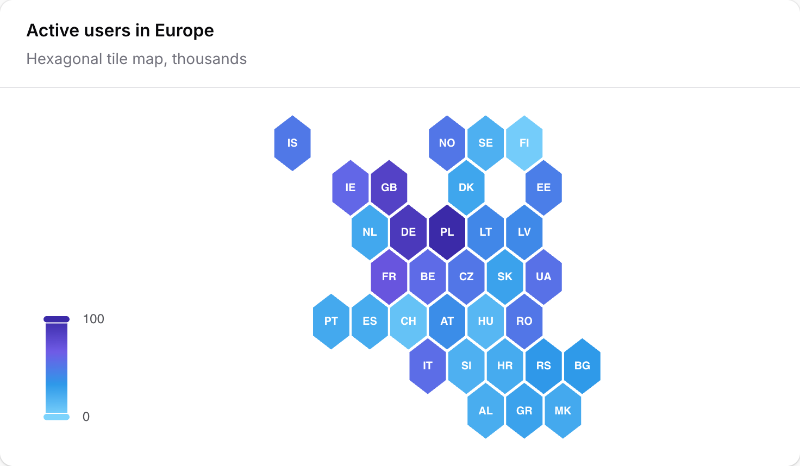</picture></a><br><sub><b>GeoJSON map</b></sub></td>
<td width="33%" align="center"><a href="https://github.com/happenv-com/filament-enhanced-charts/blob/1.x/DEMO.md#circular-layout"><picture><source media="(prefers-color-scheme: dark)" srcset="screens/graph-dark.png">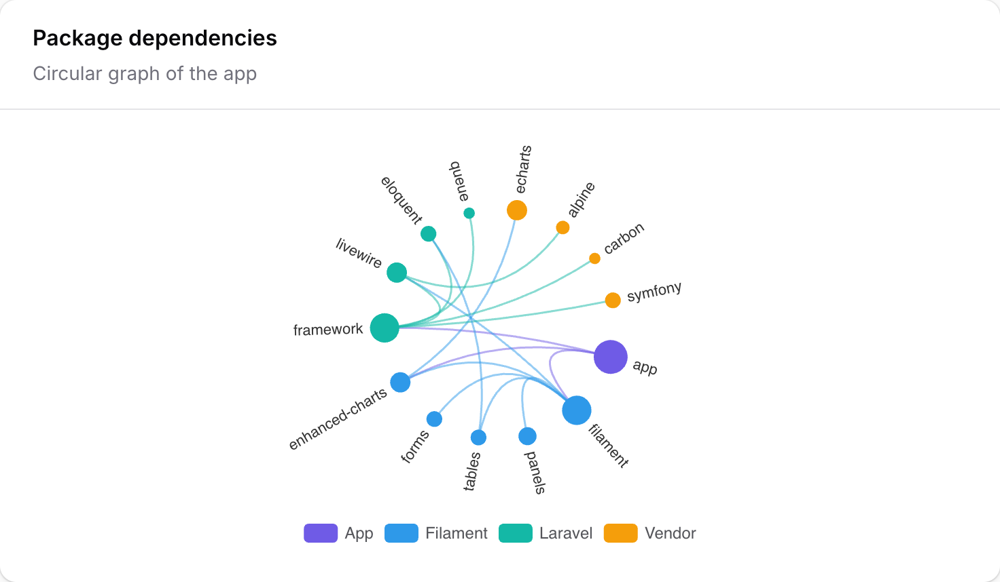</picture></a><br><sub><b>Graph</b></sub></td>
<td width="33%" align="center"><a href="https://github.com/happenv-com/filament-enhanced-charts/blob/1.x/DEMO.md#gantt-chart-via-renderitem"><picture><source media="(prefers-color-scheme: dark)" srcset="screens/custom-dark.png">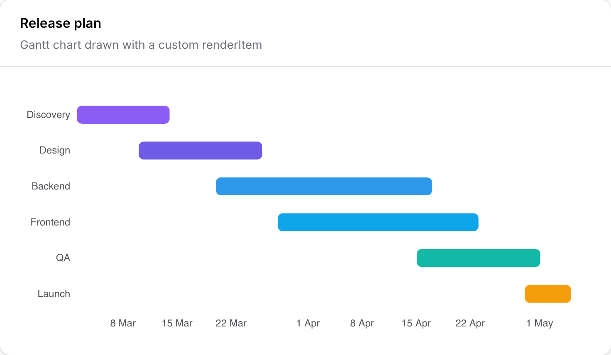</picture></a><br><sub><b>Custom Gantt</b></sub></td>
</tr>
</table>

<p align="center">
    <a href="https://github.com/happenv-com/filament-enhanced-charts/blob/1.x/DEMO.md"></a>
</p>

## Requirements

| Package  | Versions  |
|----------|-----------|
| PHP      | 8.4 – 8.5 |
| Laravel  | 12, 13    |
| Filament | 4, 5      |

## Installation

Install the package via Composer:

```bash
composer require happenv-com/filament-enhanced-charts
```

Register the plugin on each Filament panel that should render charts:

```php
use Happenv\FilamentEnhancedCharts\FilamentEnhancedChartsPlugin;

public function panel(Panel $panel): Panel
{
    return $panel
        ->plugins([
            FilamentEnhancedChartsPlugin::make(),
        ]);
}
```

After installing or upgrading, republish the compiled JavaScript assets:

```bash
php artisan filament:assets
```

Upgrading from `filament-echarts` 2.x? See [UPGRADING.md](https://github.com/happenv-com/filament-enhanced-charts/blob/1.x/UPGRADING.md).

## Configuration

Publish the config file:

```bash
php artisan vendor:publish --tag="filament-enhanced-charts-config"
```

It lists the chart types the `make:filament-enhanced-charts` generator offers (see [Generating a widget](#generating-a-widget)):

```php
return [
    'chart_options' => [
        'Line', 'Bar', 'Pie', 'Scatter', 'Candlestick', 'Radar',
        'Boxplot', 'Sunburst', 'Parallel', 'Sankey', 'Funnel', 'Gauge',
    ],
];
```

Optionally, publish the views and translations:

```bash
php artisan vendor:publish --tag="filament-enhanced-charts-views"
php artisan vendor:publish --tag="filament-enhanced-charts-translations"
```

## Usage

### Generating a widget

The generator asks for the chart type, an optional resource and the panel, and writes a ready-to-edit widget from the matching stub:

```bash
php artisan make:filament-enhanced-charts BlogPostsChart
```

### Your first widget

A chart widget is a regular Filament widget: extend `EnhancedChartWidget` and return an `Option` from
`getOption()`. That is the whole story.

```php
use Happenv\FilamentEnhancedCharts\Option\Axis\CategoryAxis;
use Happenv\FilamentEnhancedCharts\Option\Option;
use Happenv\FilamentEnhancedCharts\Option\Series\BarSeries;
use Happenv\FilamentEnhancedCharts\Option\Series\LineSeries;
use Happenv\FilamentEnhancedCharts\Widgets\EnhancedChartWidget;

class BlogPostsChart extends EnhancedChartWidget
{
    protected static ?string $heading = 'Blog posts';

    protected function getOption(): Option
    {
        return Option::cartesian()
            ->xAxis(CategoryAxis::make()->data(['Jan', 'Feb', 'Mar']))
            ->series(
                LineSeries::make()->name('Posts')->smooth()->data([10, 15, 8]),
                BarSeries::make()->name('Comments')->data([45, 60, 32]),
            );
    }
}
```

Two entry points exist on `Option`:

- `Option::make()` — a blank slate.
- `Option::cartesian()` — a batteries-included preset for the common case: an axis-triggered
  tooltip and a top legend, ready for `->xAxis()` + `->series()`.

When an x-axis is set and no y-axis is given, a `ValueAxis` is defaulted for you. Set
`->yAxis(...)` explicitly when you need something else (e.g. a `CategoryAxis` for a heatmap).

### The option model

Everything under `Happenv\FilamentEnhancedCharts\Option\*` is a fluent builder that serializes to the
exact [ECharts option](https://echarts.apache.org/en/option.html) shape. This package deliberately
does **not** re-document every chart type — the ECharts docs and
[examples gallery](https://echarts.apache.org/examples/en/) are the reference; the builders mirror
them method-for-method.

| Kind | Classes |
|---|---|
| Root | `Option` |
| Axes | `Axis\CategoryAxis`, `Axis\ValueAxis`, `Axis\TimeAxis`, `Axis\LogAxis` |
| Series | `Series\LineSeries`, `BarSeries`, `PieSeries`, `ScatterSeries`, `EffectScatterSeries`, `CandlestickSeries`, `BoxplotSeries`, `HeatmapSeries`, `RadarSeries`, `GaugeSeries`, `FunnelSeries`, `SankeySeries`, `ChordSeries`, `SunburstSeries`, `TreemapSeries`, `TreeSeries`, `GraphSeries`, `ParallelSeries`, `ThemeRiverSeries`, `PictorialBarSeries`, `MapSeries`, `LinesSeries`, `CustomSeries` |
| Components | `Component\Legend`, `Tooltip`, `Title`, `Grid`, `DataZoom`, `VisualMap`, `Toolbox` (+ `Toolbox\*` features), `AxisPointer`, `Brush`, `Polar`, `AngleAxis`, `RadiusAxis`, `Radar`, `Geo`, `Calendar`, `SingleAxis`, `Parallel`, `ParallelAxis`, `Matrix`, `Dataset`, `Transform`, `Graphic` (+ `Graphic\*` elements) |
| Styles | `Style\ItemStyle`, `LineStyle`, `AreaStyle`, `Label`, `Emphasis` |
| Marks | `Mark\MarkLine`, `MarkPoint`, `MarkArea` |
| Data | `DataPoint`, `SankeyNode`, `SankeyLink` |

Conventions that hold across the whole tree:

- **`::make()` + fluent setters.** Every builder is created with `::make()` and configured by
  chaining; setters return `$this`.
- **One or many.** Slots that ECharts accepts as "an object or an array of objects" are variadic:
  `->grid(...)`, `->xAxis(...)`, `->title(...)`, `->series(...)`, `->visualMap(...)`, … Pass one or
  several; the emitted JSON follows ECharts' single-vs-array convention automatically.
- **Builders or arrays.** Sub-config setters accept the matching builder *or* a plain array:
  `->itemStyle(ItemStyle::make()->borderRadius(4))` and `->itemStyle(['borderRadius' => 4])` are
  equivalent.
- **Conditional building.** All builders use Laravel's `Conditionable`:
  `->when($this->filter === 'year', fn (Option $o) => $o->dataZoom(...))`.
- **Per-point configuration.** Wherever a data item can be more than a value, pass a `DataPoint`:
  `DataPoint::make(1048)->name('Search')->itemStyle(ItemStyle::make()->color('#c23531'))`.

#### The `raw()` escape hatch

Every node (`Option`, each series, axis, component, `DataPoint`, …) accepts
`->raw(array $options)`. Raw options are **deep-merged over the typed output, raw wins** — so you
can reach any ECharts option the typed API doesn't model yet without abandoning the builders:

```php
LineSeries::make()
    ->data($values)
    ->raw(['universalTransition' => true]);
```

To skip the typed model entirely, return a raw tree from a blank `Option`:

```php
protected function getOption(): Option
{
    return Option::make()->raw([
        'xAxis' => ['type' => 'category', 'data' => ['A', 'B']],
        'series' => [['type' => 'bar', 'data' => [5, 7]]],
    ]);
}
```

Prefer the typed methods — `raw()` is the last resort, not the default.

### Formatters and JS callbacks

Strings passed to `formatter()`-style methods are treated as literal
[ECharts templates](https://echarts.apache.org/en/option.html#tooltip.formatter) and pass through
unchanged. For a real client-side function, pass Filament's `RawJs`: it is serialized as a marker
and revived into a genuine JS function in the browser.

```php
use Filament\Support\RawJs;
use Happenv\FilamentEnhancedCharts\Option\Axis\ValueAxis;
use Happenv\FilamentEnhancedCharts\Option\Component\Tooltip;

Option::make()
    ->tooltip(Tooltip::make()->trigger('axis')->formatter('{b}: {c} pcs')) // template string
    ->yAxis(ValueAxis::make()->axisLabel(
        RawJs::make('(value) => (value / 1000) + "k"'),                    // executable JS
    ));
```

`RawJs` works anywhere in the tree — `renderItem` on a `CustomSeries`, `symbolSize` callbacks,
`animationDelay` functions, `labelLayout`, colors-by-callback, and so on. Inside these callbacks
the `echarts` global is available, so gallery snippets using `echarts.format.addCommas(...)` or
`echarts.graphic.clipRectByRect(...)` port verbatim.

### Numbers

Anywhere a number is accepted you may pass a native `\BcMath\Number` instead of
`int|float|string`; it is serialized as an exact numeric literal rather than a lossy float.

### Feeding data from Eloquent

A series' `data()` and an axis' `data()` take any `iterable`, so a `Collection` works — but the
**shape** matters:

- **A positional list** (a bare `pluck` or an array) → pass it straight to `data()`. Keys are
  dropped (the series/axis is positional), so a keyed Collection never mis-serializes to an object:

  ```php
  $totals = Order::query()->orderBy('day')->pluck('total');   // [120, 90, 140, …]
  LineSeries::make()->data($totals);
  ```

- **A keyed map** where the key is the label (`pluck('total', 'channel')`, a `groupBy` count) → use
  `ChartData::fromPairs()` to split it into labels + values:

  ```php
  use Happenv\FilamentEnhancedCharts\Data\ChartData;

  $data = ChartData::fromPairs(Order::query()->pluck('total', 'channel')); // ['B2B' => 60, …]

  Option::make()
      ->series(PieSeries::make()->data($data->toDataPoints()));            // named slices
  // or, for a cartesian chart:
  Option::cartesian()
      ->xAxis(CategoryAxis::make()->data($data->labels()))
      ->series(BarSeries::make()->data($data->values()));
  ```

- **Tabular rows for multiple series** → build a `Dataset` and let each series `encode()` its
  columns. `Dataset::fromModels()` projects a query result to just the chart columns (never the
  full attribute bag) — don't hand a `Collection<Model>` to `data()`:

  ```php
  Option::make()
      ->dataset(Dataset::fromModels(
          Order::query()->selectRaw('day, sum(total) total, channel')->get(),
          columns: ['day', 'total', 'channel'],
      ))
      ->series(LineSeries::make()->encode(x: 'day', y: 'total'));
  ```

#### Time series

For "per day/week/month" aggregations, [`flowframe/laravel-trend`](https://github.com/flowframe/laravel-trend)
is the recommended companion: it handles the per-driver date bucketing (Postgres/MySQL/MariaDB/
SQLite) and gap-fills empty periods with zeros. It is an optional `suggest` — install it only if you
need time series:

```bash
composer require flowframe/laravel-trend
```

Feed its result straight to `ChartData::fromTimeSeries()`:

```php
use Flowframe\Trend\Trend;
use Happenv\FilamentEnhancedCharts\Data\ChartData;

$data = ChartData::fromTimeSeries(
    Trend::query($this->scopedOrders())
        ->between(now()->subDays(30), now())
        ->perDay()
        ->sum('total'),
);

Option::cartesian()
    ->xAxis(CategoryAxis::make()->data($data->labels()))
    ->series(LineSeries::make()->smooth()->data($data->values()));
```

`ChartData::fromTimeSeries()` reads `date`/`aggregate` off each row with `data_get()`, so it is
decoupled from the trend package — any `Collection` of rows carrying a label and a value column
works (pass `labelKey:`/`valueKey:` for different column names).

#### Shortcut: a chart from just data + a type

When the chart is a single series of one of the common types, the `HasChartData` trait writes
`getOption()` for you — declare the data and (optionally) the type, nothing else:

```php
use Happenv\FilamentEnhancedCharts\Concerns\HasChartData;
use Happenv\FilamentEnhancedCharts\Data\ChartData;
use Happenv\FilamentEnhancedCharts\Enums\ChartType;
use Happenv\FilamentEnhancedCharts\Widgets\EnhancedChartWidget;

class SalesByChannelChart extends EnhancedChartWidget
{
    use HasChartData;

    protected static ?string $heading = 'Sales by channel';

    protected function getData(): ChartData
    {
        return ChartData::fromPairs(Order::query()->pluck('total', 'channel'));
    }

    protected function chartType(): ChartType
    {
        return ChartType::Bar; // Line (default), Area, Bar, or Pie
    }
}
```

`ChartType` is a curated set — `Line`, `Area`, `Bar`, `Pie` — that maps cleanly onto the
`labels + values` (or, for pie, the named `DataPoint`) shape. The trait builds a cartesian option
(category x-axis + value y-axis) for the axis types and an axis-less option for pie. The moment you
want more — a second series, custom styling, marks, a scatter's x/y pairs — implement `getOption()`
directly with the typed builders; this trait is only the shallow-end shortcut.

#### Chart presets: a chart from a dataset, without knowing chart types

`ChartType` needs you to pick the chart. When the data is an aggregate ("orders per channel per
month") and the choice should be made by a person, a settings screen or an AI, hand the package a
tabular `ChartDataset` and a **preset name** — the package says which presets can draw that data
and builds the `Option`:

```php
use Happenv\FilamentEnhancedCharts\Data\ChartDataset;
use Happenv\FilamentEnhancedCharts\Data\DatasetDimension;
use Happenv\FilamentEnhancedCharts\Data\DatasetMeasure;
use Happenv\FilamentEnhancedCharts\Presets\ChartPresets;

$dataset = ChartDataset::fromRows(
    dimensions: [DatasetDimension::time('month', 'Month'), DatasetDimension::category('channel', 'Channel')],
    measures: [new DatasetMeasure('orders', 'Orders')],
    rows: $rows, // [['month' => 'Jan 2026', 'channel' => 'Allegro', 'orders' => 12], …]
);

$presets = app(ChartPresets::class);

$presets->catalog($dataset->shape()); // [['name' => 'stacked-bar', 'description' => '…', 'requirement' => '…'], …]
$option = $presets->option('stacked-bar', $dataset); // an Option, ready for getOption()
```

- **Dimensions** split the rows. A dimension has a *kind*: `category` labels, `time` buckets (an
  *already formatted* label such as `Jan 2026`; the cartesian presets never parse it as a date) or
  `region` — ISO 3166-1 alpha-2 country codes in uppercase (`PL`, `DE`; `DatasetDimension::region()`).
  Every preset that takes a category takes a region too (it is just a label there); only
  `world-map` and `flow-lines` need regions. **Measures** are the numbers (`int|float|null`). A row is
  keyed by dimension and measure names.
- **Multi-valued dimensions.** A dimension may be marked `multiValued()`; presets that encode
  part-of-whole then refuse it — see [Data semantics](#data-semantics-grain-and-multi-valued-dimensions).
- **Measure roles.** A measure may carry a `MeasureRole` — `Min`, `Q1`, `Median`, `Q3`, `Max`, `Open`,
  `Close`, `Low`, `High` — naming the statistic it holds (`DatasetMeasure::withRole(MeasureRole::Median,
  'median', 'Median')`). `boxplot` needs exactly the five measures with the roles min, q1, median, q3,
  max, and `candlestick` the four with open, close, low, high, in any order; the preset puts them in
  the order ECharts reads. `DatasetShape` carries the roles (`roles`, `hasRole()`, `hasExactlyRoles()`),
  so `accepting()` and `catalog()` stay truthful. A role is a description, not a restriction: every
  other preset ignores roles and draws the measures as plain values, so a candlestick dataset still
  draws as a `line`. A dataset uses each role at most once.
- **Measure units.** A measure may carry a free-text `unit` (`new DatasetMeasure('revenue', 'Revenue',
  unit: 'PLN')`; `PLN`, `pcs`, `%`, `views` — the package never interprets it). On the presets that
  draw one series per measure, each *distinct* unit gets its own value axis: the first on the left,
  the second on the right, further ones alternating sides with a growing offset (60&nbsp;px steps) and
  more room in the grid. Each axis is named by its unit and takes the colour of its series when it
  carries just one; the series carry the matching `yAxisIndex` (`xAxisIndex` for the horizontal
  variants). Stacked variants stack within a unit only, never across units. A measure without a unit
  counts as a scale of its own when others have one. The number of units never changes which presets
  accept a dataset.
- `ChartDataset::fromRows()` coerces query results (numeric strings, ints as labels); the
  constructor and `fromArray()` are strict. `toArray()` / `fromArray()` round-trip through JSON, so a
  dataset can be stored; `fromArray()` throws `InvalidChartDataset` on anything malformed.
- `$dataset->shape()` is just the dimension kinds, the measure count and the measure roles; `ChartPresets::accepting($shape)`
  returns the presets that accept it, and `catalog()` the same as `name` / `description` /
  `requirement` data — what an AI needs to choose. A preset registered later shows up there with no
  change on the consumer's side.
- `option()` throws `ChartPresetException` for an unknown preset or one that does not accept the
  shape — it never renders a blank chart.

In a widget, the `HasChartPreset` trait replaces `getOption()`:

```php
use Happenv\FilamentEnhancedCharts\Concerns\HasChartPreset;

class OrdersPerChannelChart extends EnhancedChartWidget
{
    use HasChartPreset;

    protected function getDataset(): ChartDataset
    {
        return ChartDataset::fromRows(…);
    }

    protected function chartPreset(): string
    {
        return 'stacked-bar';
    }
}
```

#### Data semantics: grain and multi-valued dimensions

A `ChartDataset` is an aggregate: its rows are the measures summed per combination of dimension values.
The **grain** is what one source record is — an order, an order line, a product. A dimension is
**multi-valued** when one record of that grain carries *several* of its values: a product in several
categories, an order with several tags. Grouping by such a dimension counts the record once per value,
so the measure over that dimension is correct *per value* ("orders tagged `gift`") but the values
**do not add up to the whole** (an order with two tags is in two rows). A chart that draws the rows as
shares of a total — a pie, a stack — would show a total larger than the truth, so it would lie.

Mark such a dimension where you build the dataset; nothing else changes:

```php
DatasetDimension::category('tag', 'Tag')->multiValued();   // fluent, on any dimension
DatasetDimension::category('tag', 'Tag', multiValued: true); // or as an argument (also on region())
new DatasetDimension('tag', 'Tag', multiValued: true);
```

The flag survives `toArray()` / `fromArray()` (it is written only when true, so a v1.5 array reads
unchanged) and reaches the shape: `DatasetShape::hasMultiValuedDimension()`, `isMultiValuedAt($index)`,
`$shape->multiValued` (the positions), `withMultiValued(...$indexes)`; `describe()` and `toArray()`
mention it. `ChartPresets::accepting($shape)` and `catalog($shape)` then leave out every preset that
**encodes part-of-whole along a multi-valued dimension**, and `option()` throws `ChartPresetException`
for it, naming the dimension. A preset that merely compares values — `bar`, `grouped-bar`, `line`,
`heatmap`, `radar`, … — keeps accepting it: each value is read on its own, nothing is summed across them.
Only the dimension a chart *partitions by* matters: in `stacked-bar` the x axis may be multi-valued, the
stacked dimension may not. Marking is the consumer's responsibility — the package cannot see your joins.

| Preset | Partitions by | Why |
| --- | --- | --- |
| `pie`, `donut`, `rose` | the dimension | slices are the parts of one circle |
| `funnel` | the dimension | steps are read as proportions of the top step |
| `treemap`, `sunburst` | every dimension | a parent is the sum of its children, areas fill the whole |
| `tree` | every dimension | each node carries the sum of the leaves below it |
| `stacked-bar`, `stacked-horizontal-bar`, `stacked-area` | the second dimension (with 2 dimensions) | the stack height is the total of the series; the x axis is not summed |
| `theme-river` | the category or region (not the time) | the stream is each category's share at a period |
| `sankey` | both dimensions | node height is the flow through it and flow is conserved |
| `chord` | both dimensions | an arc is as long as its ribbons sum to |
| `graph` | both dimensions | a node is as large as its links sum to |

Not part-of-whole, so never refused: every cartesian comparison (`bar`, `horizontal-bar`, `line`,
`smooth-line`, `area`, `grouped-bar`, `multi-line`, `bar-line`, `pictorial-bar`, `polar-bar`), `heatmap`,
`calendar-heatmap`, `radar`, `parallel`, `scatter`, `effect-scatter`, `boxplot`, `candlestick`,
`gauge`, `world-map` and `flow-lines` (each cell, point or country is read alone). Stacking several
*measures* of one dimension is a different thing from partitioning by a dimension and is not refused.

A custom preset extending `AbstractChartPreset` encodes no part-of-whole unless it overrides
`partitioningDimensions(DatasetShape): array` (the positions it adds up by); the registry and
`option()` then refuse a multi-valued one for it too, even if it overrides `accepts()` itself. This is
a separate `EncodesPartOfWhole` interface rather than a new method on `ChartPreset`, so an existing
`ChartPreset` implementation keeps compiling and behaves as before.

**Built-in presets**

| Preset | Requirement |
| --- | --- |
| `pie`, `donut`, `rose`, `funnel` | 1 single-valued dimension (category, time or region) and 1 measure — a named slice per dimension value |
| `polar-bar` | 1 dimension and 1 measure — bars around a circle |
| `pictorial-bar` | 1 dimension and 1 measure — a bar chart whose bars are stacks of rounded pills (a built-in symbol, no image) |
| `bar`, `horizontal-bar`, `line`, `smooth-line`, `area` | 1 dimension and 1 or more measures — one series per measure; a value axis per unit |
| `bar-line` | 1 dimension and 2 or more measures — the first measure (or, with several units, the first unit's measures) as bars, the rest as lines; a value axis per unit |
| `grouped-bar`, `stacked-bar`, `stacked-horizontal-bar`, `multi-line`, `stacked-area` | 2 dimensions (first on the x axis, second splits it into series; for the `stacked-*` ones the second must be single-valued) and 1 measure, or 1 dimension and 2 or more measures (a value axis per unit; stacks never mix units) |
| `heatmap` | 2 dimensions (x, y) and 1 measure, with a visual map |
| `sankey` | 2 single-valued dimensions (source, target) and 1 measure |
| `graph` | 2 single-valued dimensions (source, target) and 1 measure — a force-directed network; link width is the measure, a node is as large as its links sum to |
| `chord` | 2 single-valued dimensions (source, target) and 1 measure — ribbons between arcs around a circle |
| `treemap`, `sunburst` | 1 or 2 single-valued dimensions (the second nested in the first) and 1 measure |
| `tree` | 1 to 3 single-valued dimensions (each nested in the previous) and 1 measure — a tree under a root labelled by the measure; parents are the sum of their leaves |
| `radar` | 2 dimensions (axes, entities) and 1 measure, or 1 dimension (entities) and 3 or more measures (axes) |
| `parallel` | 1 dimension (every value is a line) and 3 or more measures (one parallel axis per measure) |
| `gauge` | no dimensions and 1 measure — a single value |
| `theme-river` | 2 dimensions (1 time, 1 single-valued category or region) and 1 measure |
| `calendar-heatmap` | 1 time dimension of days written `YYYY-MM-DD`, and 1 measure |
| `scatter`, `effect-scatter` | 1 dimension (every row is a point named by it) and exactly 2 measures (x, y); the effect variant ripples |
| `boxplot` | 1 dimension and exactly 5 measures with the roles `min`, `q1`, `median`, `q3`, `max` |
| `candlestick` | 1 time dimension and exactly 4 measures with the roles `open`, `close`, `low`, `high` |
| `world-map` | 1 region dimension and 1 measure — a choropleth of countries with a visual map |
| `flow-lines` | 2 region dimensions (from, to) and 1 measure — animated lines between countries on the world map |

The flow presets (`sankey`, `graph`, `chord`, `flow-lines`) drop a null, zero or negative flow and a
flow from a node to itself, and sum repeated pairs. `boxplot`, `candlestick` and `parallel` leave out
a row that lacks one of its values rather than draw it wrongly. `custom` has no preset on purpose:
its `renderItem` is JavaScript code, not data, and an option an AI wrote must never carry
executable code — use `getOption()` and the typed `CustomSeries` for it.

**The world map.** `world-map` and `flow-lines` draw on a simplified world map shipped with the
package (about 160&nbsp;KB, built from [Natural Earth](https://www.naturalearthdata.com/) 1:110m
countries, public domain — see `NOTICE`; regions are keyed by ISO alpha-2 code and named in the app
locale through `intl`, in English where it has no name). It is a Filament asset
(`filament-enhanced-charts-map-world`) that a page requests only when a chart's option uses the map:
`HasChartPreset` supplies it through `getMaps()` by itself, and anything else can ask
`ChartMaps::for($option)` for the `name => URL` pairs (an empty array for a chart that draws no map)
and pass them as `maps` to the chart component. Run `php artisan filament:assets` after upgrading, as
for any Filament asset. Codes the map lacks (small states) are skipped; the map is for orientation, not
for borders, and takes no position on disputed ones. Map presets are not available in table-cell charts.

**Registering your own preset**

Implement `ChartPreset` (or extend `AbstractChartPreset`, which checks `accepts()` for you) and
register it from a service provider. A preset that encodes part-of-whole also implements
`EncodesPartOfWhole` (see [Data semantics](#data-semantics-grain-and-multi-valued-dimensions)); one that
does not needs to know nothing of it. A name registered twice replaces the earlier preset, so an app
can also override a built-in.

```php
use Happenv\FilamentEnhancedCharts\Data\ChartDataset;
use Happenv\FilamentEnhancedCharts\Data\DatasetShape;
use Happenv\FilamentEnhancedCharts\Option\Option;
use Happenv\FilamentEnhancedCharts\Presets\AbstractChartPreset;
use Happenv\FilamentEnhancedCharts\Presets\ChartPresets;

final class BulletPreset extends AbstractChartPreset
{
    public function name(): string { return 'bullet'; }                      // stable kebab-case key

    public function description(): string { return 'Compares a value with a target.'; } // one English sentence

    public function requirement(): string { return '1 dimension and 2 measures'; }

    public function accepts(DatasetShape $shape): bool
    {
        return $shape->dimensionCount() === 1 && $shape->measures === 2;
    }

    protected function build(ChartDataset $dataset): Option
    {
        return Option::make()->…;
    }
}

// In a service provider's boot():
$this->app->make(ChartPresets::class)->register(new BulletPreset);
```

### Colors

Color setters (`color()`, `backgroundColor()`, `borderColor()`, `shadowColor()`, …) accept:

- any CSS color string (`'#7c3aed'`, `'rgb(124, 58, 237)'`),
- an ECharts gradient/pattern array,
- a **Filament palette** — `Color::Amber` resolves to its 500 shade, and Filament's `oklch(...)`
  values are converted to `rgb()` so ECharts can both paint them and derive hover shades:

```php
use Filament\Support\Colors\Color;

BarSeries::make()
    ->color(Color::Emerald)          // 500 shade
    ->data($values);

LineSeries::make()
    ->color(Color::Amber[600])       // an explicit shade
    ->data($values);
```

### Dark mode

Dark mode is automatic. Charts render transparent over the Filament card, and when the panel is in
dark mode the package overlays a theme layer client-side — axis lines/labels, split lines, legend,
title, tooltip, visual maps, parallel axes and outside series labels are all lightened for
readability. The theme reapplies live when the user toggles light/dark. You write the option once;
both modes just work.

Tip: skip forced `backgroundColor` and hardcoded text colors in your options — inherit the card
and let the theme adapt.

### Page scrolling

By default the mouse wheel scrolls the **page**, not the chart: `inside` data zoom stops
wheel-zooming (drag-to-pan is kept) and any `roam` is downgraded to drag-pan. That way a dashboard
full of charts never traps the user's scroll.

Opt a chart back into wheel-zoom (e.g. a full-bleed map) on the widget:

```php
protected static bool $scrollable = false;
```

or per option, which wins over the widget default:

```php
Option::make()->scrollable(false);
```

### Widget configuration

```php
protected static ?string $heading = 'Revenue';        // or override getHeading()
protected static ?string $subheading = 'Last 30 days'; // or getSubheading()
protected static bool $isCollapsible = true;           // or isCollapsible()
protected static int $contentHeight = 400;             // px, default 300; or getContentHeight()
protected static ?string $footer = 'Updated hourly';   // or getFooter() (string|Htmlable|View)
protected static string $chartId = 'revenueChart';     // stable DOM id, optional
protected static string $renderer = 'canvas';          // or 'svg'; or getRenderer()
protected int | string | array $columnSpan = 'full';
```

The header disappears entirely when no heading, subheading or filters are set.

#### Deferred loading

Don't hold up the page for a slow query:

```php
protected static bool $deferLoading = true;

protected function getOption(): Option
{
    if (! $this->readyToLoad) {
        return Option::make();
    }

    return Option::cartesian()->series(/* the expensive part */);
}
```

#### Loading indicator

```php
protected static ?string $loadingIndicator = 'Loading…'; // or getLoadingIndicator() returning a View
```

#### Live updating (polling)

Widgets poll every 5 seconds by default. Change or disable it with an instance property:

```php
protected ?string $pollingInterval = '10s';

protected ?string $pollingInterval = null; // disable
```

Updates are diffed server-side — the chart only re-renders when the resolved options actually
changed.

### Filtering chart data

#### Single select

Return options from `getFilters()` and read the active value from `$this->filter`:

```php
public ?string $filter = 'month';

protected function getFilters(): ?array
{
    return [
        'week' => 'Last week',
        'month' => 'Last month',
        'year' => 'This year',
    ];
}

protected function getOption(): Option
{
    $data = match ($this->filter) {
        'week' => $this->weekly(),
        'month' => $this->monthly(),
        'year' => $this->yearly(),
    };

    return Option::cartesian()->series(LineSeries::make()->data($data));
}
```

A select appears in the widget header and the chart updates live on change.

#### Filter schema

For a richer filter form, implement the package's `HasFiltersSchema` **contract** and use
Filament's chart-widget filters trait; filter values arrive in `$this->filters`:

```php
use Filament\Forms\Components\DatePicker;
use Filament\Schemas\Schema;
use Filament\Widgets\ChartWidget\Concerns\HasFiltersSchema;
use Happenv\FilamentEnhancedCharts\Contracts\HasFiltersSchema as HasFiltersSchemaContract;
use Happenv\FilamentEnhancedCharts\Widgets\EnhancedChartWidget;

class BlogPostsChart extends EnhancedChartWidget implements HasFiltersSchemaContract
{
    use HasFiltersSchema;

    public function filtersSchema(Schema $schema): Schema
    {
        return $schema->components([
            DatePicker::make('date_start')->default(now()->subMonth()),
            DatePicker::make('date_end')->default(now()),
        ]);
    }

    public function updatedInteractsWithSchemas(string $statePath): void
    {
        parent::updatedInteractsWithSchemas($statePath);

        $this->updateOptions();
    }

    protected function getOption(): Option
    {
        $start = $this->filters['date_start'] ?? null;
        $end = $this->filters['date_end'] ?? null;

        // ...
    }
}
```

Implementing the contract is what makes the filter dropdown render — don't skip it.

### Maps (GeoJSON)

A `MapSeries` or `geo` component needs its map registered client-side. Return `name => url` pairs
from `getMaps()`; each is fetched and passed to `echarts.registerMap()` before first paint:

```php
use Happenv\FilamentEnhancedCharts\Option\Component\VisualMap;
use Happenv\FilamentEnhancedCharts\Option\Series\MapSeries;

/** @return array<string, string> */
public function getMaps(): array
{
    return ['world' => asset('geo/world.json')];
}

protected function getOption(): Option
{
    return Option::make()
        ->visualMap(VisualMap::continuous()->min(0)->max(100)->calculable())
        ->series(MapSeries::make()->map('world')->roam()->data($rows));
}
```

### Charts in table cells

`EnhancedChartColumn` renders a small chart per row. Three presets cover the common cases; `chart()`
takes over for anything else. Return `null`/empty data to render nothing for that row.

```php
use Happenv\FilamentEnhancedCharts\Columns\EnhancedChartColumn;

EnhancedChartColumn::make('trend')
    ->sparkline(fn (Product $record): array => $record->daily_sales)
    ->fill(),                                      // area fill; ->bars() for bar sparklines

EnhancedChartColumn::make('ohlc')
    ->width(160)                                   // px, '100%', or a Closure; height(int) too
    ->candles(fn (Product $record): array => $record->ohlc_rows), // [open, close, low, high] rows

EnhancedChartColumn::make('mix')
    ->pie(fn (Order $record): array => ['B2B' => 60, 'B2C' => 40]), // donut

EnhancedChartColumn::make('custom')
    ->chart(fn (Server $record): ?Option => Option::make()
        ->series(GaugeSeries::make()->data([DataPoint::make($record->cpu)]))),
```

Cell charts ship with a sensible baseline (tooltip escaping the cell, no legend, tight margins)
and are disposed cleanly as rows leave the DOM. `->renderer('svg')` is available per column.
Custom `->chart()` closures can start from the same baseline via
`EnhancedChartColumn::cellOption()` (optionally passing the tooltip trigger, e.g. `'axis'`).

## Testing your application

The package registers a Livewire `Testable` mixin with chart assertions for your app's tests:

```php
use function Pest\Livewire\livewire;

livewire(RevenueChart::class)
    ->assertChartSeriesCount(2)
    ->assertChartHasSeries('line')
    ->assertChartOptions(fn (array $options): bool => $options['series'][0]['smooth'] === true);
```

`RawJs` and `BcMath\Number` values appear in the resolved options as `['__js__' => '…']` markers — see [UPGRADING.md](https://github.com/happenv-com/filament-enhanced-charts/blob/1.x/UPGRADING.md#6-the-__js__-marker-relevant-for-tests).

## Translations

Charts speak your app's locale. Month and day names on time axes and calendars, the toolbox, legend selector and the screen-reader (aria) description all follow `app()->getLocale()` — in every language Filament ships:

`am` `ar` `az` `bg` `bn` `bs` `ca` `ckb` `cs` `da` `de` `el` `en` `es` `et` `eu` `fa` `fi` `fil` `fr` `he` `hi` `hr` `hu` `hy` `id` `it` `ja` `ka` `km` `ko` `ku` `lt` `lus` `lv` `mk` `mn` `ms` `my` `nb` `ne` `nl` `pl` `pt` `pt_BR` `ro` `ru` `si` `sk` `sl` `sq` `sr_Cyrl` `sr_Latn` `sv` `sw` `tg` `th` `tr` `uk` `ur` `uz` `vi` `zh_CN` `zh_HK` `zh_TW`

Each language is an ECharts locale object in `resources/lang/{locale}/locale.php`. Where ECharts has its own translation it is used as is (`npm run locales` regenerates those files); for the others the month and day names come from CLDR and the rest is translated in the package. A missing key falls back to English.

Publish the files to change a string or add a language:

```bash
php artisan vendor:publish --tag="filament-enhanced-charts-translations"
```

## AI assistants (Laravel Boost)

The package ships a [Laravel Boost](https://laravel.com/docs/boost) skill, `filament-enhanced-charts-development`, in `resources/boost/skills/`. `php artisan boost:install` (or `boost:update`) offers it to your coding agent: how to write a chart widget with the typed option model, shape Eloquent data, use `raw()` and `RawJs`, add filters, polling and table-cell charts, and test the resolved options, with the pitfalls that come with them.

## Development

```bash
composer test          # the test suite
composer phpstan       # static analysis
composer cs            # fix code style: composer normalize, Rector, Pint
composer ci            # everything CI checks, locally
```

The package's JavaScript is built by `bin/build.js` into `resources/dist`, which is committed. After changing `resources/js`, rebuild and commit the result — CI refuses outdated assets:

```bash
npm ci
npm run build   # or `npm run dev` to rebuild on change
npm run lint    # Prettier check, as in CI
```

## Upgrading

Breaking changes and how to migrate are described in [UPGRADING](https://github.com/happenv-com/filament-enhanced-charts/blob/1.x/UPGRADING.md) for every major version.

## Changelog

See [CHANGELOG](https://github.com/happenv-com/filament-enhanced-charts/blob/1.x/CHANGELOG.md) and [GitHub releases](https://github.com/happenv-com/filament-enhanced-charts/releases) for what has changed recently.

## Contributing

See [CONTRIBUTING](https://github.com/happenv-com/filament-enhanced-charts/blob/1.x/.github/CONTRIBUTING.md) for details.

## Security vulnerabilities

Please review [our security policy](https://github.com/happenv-com/filament-enhanced-charts/blob/1.x/.github/SECURITY.md) on how to report security vulnerabilities.

## Credits

- [Happenv sp. z o.o.](https://happenv.com)
- [webard](https://github.com/webard)
- [elemind](https://github.com/elemind)
- Strongly inspired by [Leandro Ferreira's Apex Charts plugin](https://filamentphp.com/plugins/leandrocfe-apex-charts)
- [All contributors](https://github.com/happenv-com/filament-enhanced-charts/graphs/contributors)

## License

The MIT License (MIT). See [License File](https://github.com/happenv-com/filament-enhanced-charts/blob/1.x/LICENSE.md) for more information.

---

<p align="center">
    <a href="https://happenv.com">
        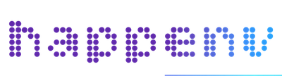
    </a>
</p>
